# On-Device Voice Interface for Robots

[](https://github.com/22by7-raikar/On-Device-Voice-Interface/actions/workflows/ci.yml)

A robot that hears a person across a noisy room, turns toward them,
understands a free-form request, acts on it safely, and stops the instant it is
told to, all on-device. C++17 on a laptop GPU (RTX 3060, 6 GB):
[whisper.cpp](https://github.com/ggerganov/whisper.cpp) for speech
recognition, with an array front end, a small local LLM with validated tool
calls, TTS and barge-in added milestone by milestone.

> **Status: M0.** The listening loop works end to end (PCM in → utterances →
> Whisper → one JSON event per utterance). Everything else in the diagram below
> is planned; the roadmap says when.

## Architecture



Every stage exists because the robot needs it, not as a feature checklist:

| Stage | Why |
|---|---|
| Beamforming + denoising | The speaker is metres away; the robot's own fans and motors sit next to the mics. |
| Direction of arrival | The robot turns to face whoever spoke. |
| On-device inference | A robot cannot stall when the network drops, and a cloud round-trip is too slow to stop it. |
| Echo cancellation | The robot talks and must not hear itself as a command. |
| Barge-in | "Stop" mid-sentence or mid-motion is a safety feature. |
| Validated tool calls | An LLM must never send an out-of-range or stale motion command. |

Design, contracts and trade-offs: [docs/architecture.md](docs/architecture.md);
the reasoning behind them: [docs/decisions.md](docs/decisions.md).
The API reference is generated with Doxygen.

## Roadmap

| | Milestone | Measured result |
|---|---|---|
| ✅ M0 | Repository, listening loop, CI | Builds and tests on every push |
| M1 | Benchmark harness, VAD comparison | WER vs SNR per Whisper size; VAD false triggers on music and noise |
| M2 | Front end: beamforming, DOA, denoising | WER and SI-SDR gains under fan noise; DOA error |
| M3 | Real-time loop: live capture, ASR worker thread | Microphone-to-transcript latency, P50/P95 |
| M4 | Agent: LLM tool calls, validator, simulated robot | Invalid and stale calls rejected; tool-call accuracy |
| M5 | TTS, echo cancellation, barge-in | Stop latency; false barge-in rate with music playing |
| M6 | Evaluation and demo | Results tables and a demo video |

No model is trained: every model is a pretrained, open checkpoint, and public
datasets (LibriSpeech, MUSAN, DEMAND, RIRs) are used for evaluation only.

## Quick start

```bash
git clone --recursive https://github.com/22by7-raikar/On-Device-Voice-Interface.git
cd On-Device-Voice-Interface
cmake --preset release && cmake --build --preset release -j
ctest --preset release                  # no model weights needed
scripts/download_model.sh base.en       # -> models/ggml-base.en.bin

scripts/listen.sh --model models/ggml-base.en.bin --mic            # live (ALSA)
scripts/listen.sh --model models/ggml-base.en.bin --wav speech.wav  # replay
```

One event per utterance (illustrative values; latency abridged):

```json
{"event":"transcript","utterance_id":1,"capture_device":"alsa:default","transport":"alsa_pcm",
 "duration_ms":1840,"speech_ms":1120,"finalization_reason":"end_silence","asr_ok":true,
 "asr_error":"","transcript":"Come over here and look left.",
 "latency":{"asr_ms":...,"post_utterance_ms":...},"stream":{"start_frame":112,"end_frame":203}}
```

Requirements: CMake ≥ 3.21, a C++17 compiler (CI: GCC 13 on Ubuntu 24.04),
Python 3 for the protocol test, ffmpeg for `scripts/listen.sh`, and the CUDA
toolkit for `--preset cuda`.

## `odvi_listen`

Reads raw S16LE PCM on stdin and writes JSON Lines on stdout.

| Option | |
|---|---|
| `--rate <hz> --channels <1\|2>` | Required. Input format; 8–192 kHz, resampled to 16 kHz with an anti-aliased polyphase filter. |
| `--model <path>` | Required. whisper.cpp GGML model. |
| `--threads <n>` | ASR threads (default 4). |
| `--language <code>` | Language hint, or `auto` (default `en`). |
| `--capture-device`, `--transport` | Labels copied into every event. |

Exit status: 0 on success, 2 for invalid arguments (before the model loads),
1 for malformed input or any failed transcription.

## Development

| Task | Command |
|---|---|
| Debug build + tests | `cmake --preset debug && cmake --build --preset debug && ctest --preset debug` |
| AddressSanitizer + UBSan | `cmake --preset asan && cmake --build --preset asan && ctest --preset asan` |
| CUDA build | `cmake --preset cuda && cmake --build --preset cuda` |
| API docs | `doxygen docs/Doxyfile` → `docs/api/html/index.html` |
| Diagrams | `docs/diagrams/render.sh` (Mermaid sources → SVG) |
| Format | `clang-format -i $(git ls-files 'src/*.h' 'src/*.cpp' 'apps/*.cpp' 'tests/*.cpp')` |

Presets build with `-Wall -Wextra -Wpedantic -Wshadow -Werror`. CI runs the
Release and sanitizer suites, a CUDA compile (no GPU on the runners, so
compile-only), clang-format, and Doxygen with warnings as errors.

```
src/odvi/   audio · segmentation · asr · pipeline · report
apps/       odvi_listen
tests/      GoogleTest suite and the stdout protocol test
scripts/    model download, live and replay listening
docs/       architecture, decision log, diagrams, Doxyfile
```

## Prior work

The audio decoding, utterance segmentation and ASR integration started in
[cpp-edge-audio](https://github.com/22by7-raikar/cpp-edge-audio), which
studies when audio is worth sending to ASR at all. Its quality gate returns
here in M1 as one of the baselines in the VAD comparison.

## License

MIT. See [LICENSE](LICENSE). whisper.cpp (MIT) is a git submodule, and dr_wav
(public domain / MIT-0) is vendored in `third_party/`.
