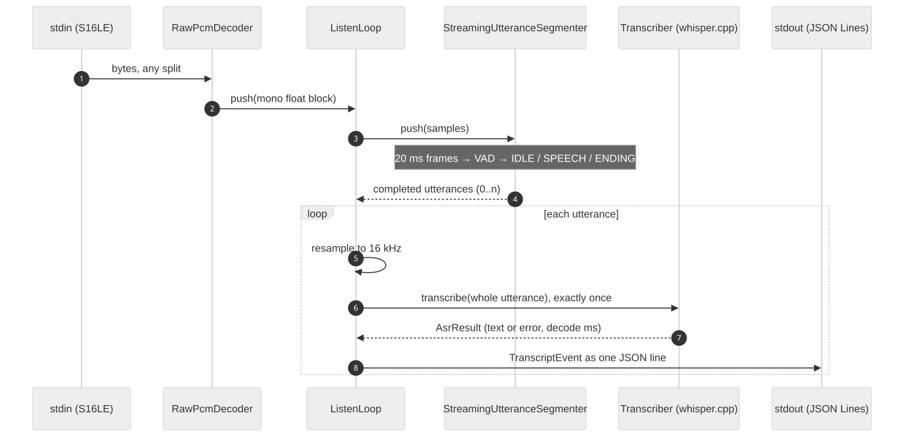

# Architecture

This document describes the target system, what exists today, and the
contracts between the parts. API detail lives in the Doxygen reference
(`docs/Doxyfile`); every subsystem below maps to a Doxygen group.

## Purpose and design goals

A robot that hears a person across a noisy room, turns toward them,
understands a free-form request, acts on it safely, and stops the instant it is
told to, all on-device. Each component exists because the robot needs it:

| Component | Why the robot needs it |
|---|---|
| Beamforming + denoising | The speaker is metres away; the robot's own fans and motors sit next to the mics (ego-noise). |
| Direction of arrival | The robot turns to face whoever spoke. |
| On-device inference | A robot cannot stall when the network drops, and a cloud round-trip is too slow to stop it. |
| Echo cancellation | The robot talks and must not hear its own voice as a command. |
| Barge-in | "Stop" mid-sentence or mid-motion is a safety feature; stop latency is a safety metric. |
| Validated tool calls | An LLM must never send a motion command that is out of range or left over from a cancelled request. |

Engineering goals that shape the code:

| Goal | Consequence in the design |
|---|---|
| Every stage is measurable | Each stage reports its own latency; every utterance produces exactly one event. |
| Core logic testable without models | ASR sits behind a `Transcriber` callable; the core library never links a model runtime. |
| Bounded resources | Streaming buffers are capped by configuration, independent of stream length. |
| Deterministic replay | The same input bytes produce the same events, so recordings are regression tests. |

## System overview


Green stages exist; dashed stages are planned, labelled with the milestone
that adds them (see the README roadmap). The speaker output also feeds the
echo canceller as its reference signal, and the segmenter's speech detection
during playback drives barge-in.

Today the runtime is the listening slice: raw PCM in, utterances endpointed,
each transcribed once, one JSON event per utterance out. Later milestones
insert the front end before the segmenter and the agent after ASR without
changing that contract.

## Code layout and dependency rules



```
src/odvi/
  audio/          AudioBuffer, WAV loading, RawPcmDecoder, Resampler
  segmentation/   energy/ZCR frame VAD, streaming utterance segmenter
  asr/            Transcriber interface (core) and AsrEngine (whisper.cpp, separate target)
  pipeline/       ListenLoop and TranscriptEvent
  report/         JSON encoding
apps/             executables (argument parsing and wiring only)
tests/            GoogleTest suite and the stdout protocol test
```

Rules the build enforces:

1. `odvi_core` depends only on the standard library and dr_wav. It reaches ASR
   only through `Transcriber` (`asr/transcription.h`).
2. `odvi_asr` is the only target that links whisper.cpp.
3. `apps/` contain no algorithms.
4. Tests link `odvi_core` only, so `ctest` needs no model weights.

## Subsystems

### Audio input (`audio/`)

Everything downstream consumes **mono float PCM in [-1, 1]**.

- `RawPcmDecoder` decodes an unbounded S16LE stream in blocks of at most 512
  frames with a 3-byte carry buffer, so memory is constant and reads may split
  samples at any byte. Stereo is downmixed in integer arithmetic before
  scaling. A trailing partial frame is a malformed stream: decoded frames are
  still delivered and the error is reported on the next call.
- `load_wav()` decodes any dr_wav-supported WAV and downmixes by averaging.
- `Resampler` converts between any two rates in [8, 192] kHz by a reduced
  rational factor L/M (48 → 16 kHz is 1/3; 44.1 → 16 kHz is 160/441). One
  Kaiser-windowed sinc prototype is designed at the virtual rate
  L × input rate and stored as L phases of K taps:

  | Property | Value |
  |---|---|
  | Passband | 0 to 85% of the lower Nyquist (0–6.8 kHz at 16 kHz out) |
  | Stopband | ≥ 80 dB from the lower Nyquist up |
  | Measured, 1 kHz tone vs ideal | error below −97 dB for 48→16, 44.1→16, 16→48 kHz |
  | Measured alias rejection, 48→16 kHz | −87 dB at 8.5 kHz; below −110 dB from 10 kHz |
  | Cost | K multiply-adds per output (K = 202 for 48→16 kHz) |
  | Look-ahead | about 2.1 ms at 48 kHz |

  Output is time-aligned with the input (the group delay is compensated), and
  streaming in any block sizes is bit-identical to a one-shot conversion; both
  are tested. Linear interpolation, used before, passed 8.5–23 kHz tones into
  the 16 kHz output at full level ([D1](decisions.md)).

### Segmentation (`segmentation/`)

Segmentation runs at the internal rate of 16 kHz. `vad_frame_is_speech()` classifies a 20 ms frame as speech if its RMS reaches
0.005 and its zero-crossing rate stays below 3,000/s. It is cheap and
transparent, and it is the baseline the benchmark compares neural VADs
against. `run_vad()` applies the same classifier offline to a whole buffer.

`StreamingUtteranceSegmenter` endpoints a live stream with a three-state
machine advanced once per frame:



| Parameter | Default | Effect |
|---|---:|---|
| `speech_start_frames` | 2 | Consecutive speech frames that open an utterance (40 ms). |
| `pre_roll_ms` | 250 | Audio kept before the trigger so word onsets are not clipped. |
| `end_silence_ms` | 600 | Trailing silence that closes an utterance; the main latency/accuracy trade-off. |
| `min_speech_ms` | 200 | Shorter candidates (clicks, bumps) are discarded without ASR. |
| `max_utterance_ms` | 8000 | Hard cap; bounds memory and worst-case ASR latency. |

Memory is bounded by construction: under one frame of partial samples, at most
`pre_roll_ms` of pre-roll and at most `max_utterance_ms` of utterance (about
0.5 MB at 16 kHz). `push_frame()` injects explicit speech decisions, so the
state machine is tested independently of the VAD and can be driven by a
different classifier.

### Speech recognition (`asr/`)

`Transcriber` is a `std::function<AsrResult(const float*, int)>` taking mono
16 kHz PCM. `AsrEngine` owns one whisper.cpp context (greedy decoding, no
timestamps). With `GGML_CUDA=ON` it initialises on GPU 0 and falls back to the
CPU if that fails; `backend_mode()` reports which backend is active.

### Pipeline (`pipeline/`)



`ListenLoop` resamples the input stream once, at ingress, to 16 kHz, then owns
the segmenter and calls the injected `Transcriber` **exactly once per
utterance**, on the whole utterance. ASR failures are data, not exceptions: an
error result or a thrown exception both become an event with `asr_error` set,
the loop keeps running, and it records that a failure happened.

**Event schema.** One JSON object per line, one line per utterance:

| Key | Type | Meaning |
|---|---|---|
| `event` | string | Always `transcript`. |
| `utterance_id` | int | Monotonic from 1. |
| `capture_device`, `transport` | string | Caller-supplied labels. |
| `duration_ms` | int | Utterance length, including pre-roll and trailing silence. |
| `speech_ms` | int | Frames the VAD classified as speech. |
| `finalization_reason` | string | `end_silence`, `max_duration` or `end_of_stream`. |
| `asr_ok`, `asr_error`, `transcript` | bool, string, string | ASR outcome. |
| `latency.asr_ms` | number | Whisper decode time. |
| `latency.post_utterance_ms` | number | Utterance close to event serialised. |
| `stream.start_frame`, `stream.end_frame` | int | Stream frame indices (20 ms frames, inclusive). |

stdout carries only JSON Lines and diagnostics go to stderr, so the output can
be piped straight into a consumer.

## Concurrency and resource model

The listening loop is **single-threaded and synchronous**, which keeps it
deterministic and replayable. The cost is explicit: ASR runs inside `push()`,
so while Whisper decodes an utterance the decoder stops reading stdin. The OS
pipe buffers the audio, so nothing is lost at these durations, but a long
decode delays endpointing of the next utterance.

`post_utterance_ms` excludes the speech itself and the `end_silence_ms`
endpoint wait, so it is **not** microphone-to-action latency. Measuring that,
and moving ASR to a worker thread behind a bounded queue, is milestone M3.

| Resource | Bound |
|---|---|
| Stream decoder | 3 bytes carry + one 512-frame block |
| Resampler | L × K coefficients + K input samples of history (≈ 30k floats for 44.1 → 16 kHz) |
| Segmenter | pre-roll + `max_utterance_ms` of audio (~0.5 MB at 16 kHz) |

## Error handling

- **Configuration errors** (bad sample rate, inconsistent segmenter config)
  throw `std::invalid_argument` at construction or parse time; `odvi_listen`
  exits with status 2 before loading the model.
- **Data errors** (malformed PCM tail, unreadable WAV) are reported with
  context. The listener still emits events for audio decoded before the error,
  then exits non-zero.
- **ASR failures**, returned or thrown, are recorded in the event; the
  listener exits non-zero at the end if any utterance failed.
- **Contract violations** (a frame of the wrong size, an utterance at the
  wrong rate) throw in every build type; they are never only `assert`s.

## Design decisions

**ASR exactly once per utterance, on the whole utterance.** Transcribing fixed
windows cuts words at window edges and makes cost depend on window size
instead of on what was said.

The full decision log, with context and consequences, is in
[decisions.md](decisions.md).

**A core library without a model runtime.** Faster builds, model-free tests,
and a clean seam for swapping the recogniser (a different Whisper size, a
streaming recogniser).

**Synchronous first.** A single-threaded loop is the easiest thing to make
correct and to test byte-for-byte. Concurrency is added in M3, where its
latency benefit can be measured against this baseline.

## Known limitations

- The frame VAD is energy/ZCR based and weak in non-stationary noise; M1
  compares it with neural VADs.
- No front end yet: the loop transcribes whatever the microphone delivers.
- Single-threaded; English by default (`--language auto` detects others).
